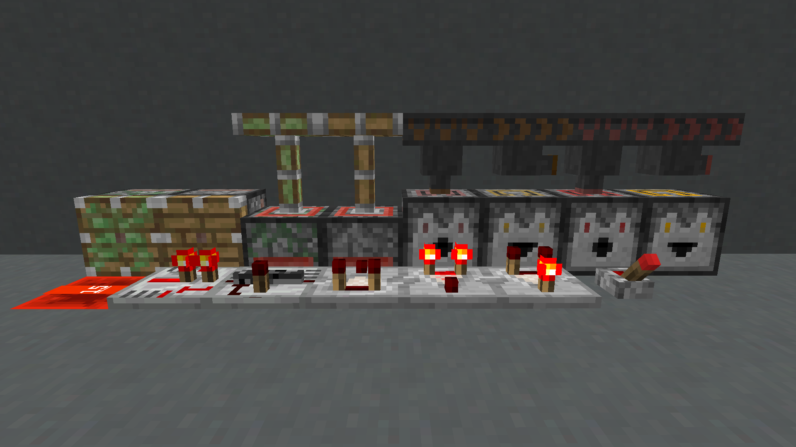

# Blockstates Backport

A client-side mod that renders blocks with the 1.8–1.12 blockstate and model JSON files from resource packs (e.g. Xekr redstone display) on Ornithe 1.7.10.

## Requirements

Needs the Minecraft 1.12.2 client jar (`libraries/com/mojang/minecraft/1.12.2/minecraft-1.12.2-client.jar`, downloaded
by the launcher with any 1.12.2 instance) or `vanillaJar` set to its path. Without it most pack models can't load.

## Config

`config/blockstates-backport.properties` (reloaded with F3+T):

| Key | Default | Description |
|---|---|---|
| `enabled` | `true` | Turns the mod on. Set it to `false` and it turns off, duh |
| `allBlocks` | `false` | Also use JSON for blocks no pack changes |
| `items` | `true` | JSON models for block items |
| `cutoutLayer` | `true` | Redstone, torches, plants… without mipmaps, like 1.12 |
| `vanillaJar` | `auto` | Path to a 1.12.2 client jar |

## License

LGPL-3.0
